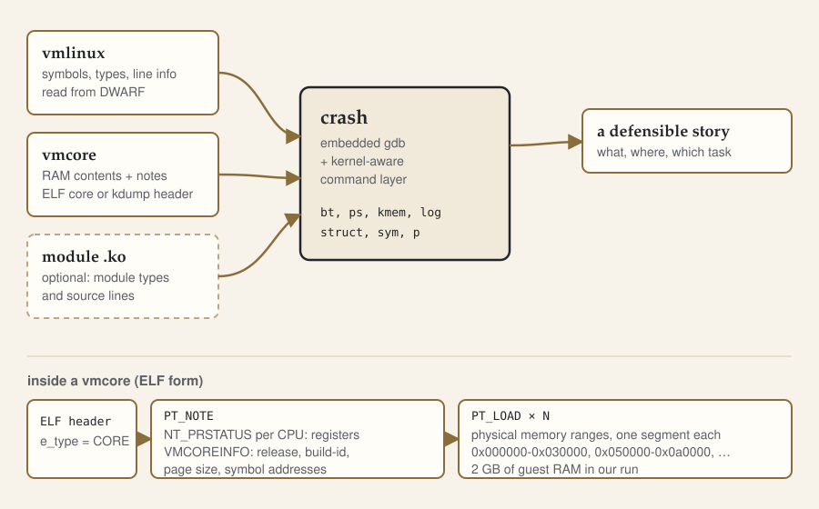

# 认识 crash：它需要什么

**一次 crash 会话，说到底是两个文件之间的对话：一个提供字节，一个提供含义。配错了，之后得到的每个答案都像事实，其实只是错觉。**

同一份 dump，两个不同的 vmlinux。第一个直接被拒：

```
WARNING: could not find MAGIC_START!
crash: ~/crash-lab/build-shift/vmlinux and ~/crash-lab/vmcore do not match!
```

第二个能打开，只丢下一行警告，然后一切看起来都很正常：

```
WARNING: kernel version inconsistency between vmlinux and dumpfile

      KERNEL: ~/crash-lab/build-2/vmlinux
    DUMPFILE: ~/crash-lab/vmcore  [PARTIAL DUMP]
        CPUS: 4
        DATE: Mon Oct 26 18:58:21 CST 2026
      UPTIME: 00:03:58
LOAD AVERAGE: 0.72, 0.21, 0.07
       TASKS: 94
    NODENAME: localhost.localdomain
     RELEASE: 7.3.0+
     VERSION: #16 SMP PREEMPT_DYNAMIC Mon Oct 26 14:48:51 CST 2026
     MACHINE: x86_64  (2693 Mhz)
      MEMORY: 2 GB
       PANIC: "Oops: Oops: 0002 [#1] SMP" (check log for details)
```

`bt` 对，`sys` 对，oops 也讲得通。可这个 namelist 仍然不是崩掉的那个内核：它是另一次构建，唯一提醒你的，就是那行你可能早就滑过去的 `WARNING`。

两个文件都是真实存在的。第一个在 `.config` 里多开了 `CONFIG_IKCONFIG=y`；第二个用与崩溃内核完全相同的 `.config`、同一份源码，在一份干净的源码副本里重新编译。这篇要讲的，就是怎么在动手读之前，判断自己处在这两种情况中的哪一种。



## 三样输入，其中一样可选

`crash` 打开一份 dump 需要两样东西：

- **namelist**，也就是构建目录里的 `vmlinux`。符号、结构体布局、枚举值、源码行号，都从这里来。它里面的 DWARF 就是"含义"。
- **内存镜像**，也就是 `vmcore`。寄存器状态、task 结构、slab 页、日志缓冲区，都从这里来。它是"字节"。

第三样输入是可选的，但只要栈里出现模块，它就变得关键：**模块自己的 `.ko`**，且带调试信息。`vmlinux` 只知道模块的基地址和少量模块文本符号，不知道 `struct crashlab_dir` 长什么样，也不知道 `crashlab.c` 的哪一行崩了。这是第 17 篇的主题。

还有一样不算 `crash` 的输入，但算你阅读时的输入：**内核源码树**。如果它还留在 DWARF 记录的路径上，`bt -l` 和 `--src` 就能给出源码行；树没了，符号和类型还在，源码没了。

反过来，清单里没有的东西也要点一下：`bzImage`。它是压缩过的启动镜像，不是 namelist。你强行喂给它，会看到这个：

```
crash: ~/crash-lab/bzImage: not a supported file format
```

`System.map` 也不是 namelist，它只有地址到名字的映射，连第一个参数都过不了：

```
crash: namelist argument required
```

只有符号没有类型，你得到的是函数名的轨迹，得不到 `struct task_struct`，而后者才是这个系列大部分内容的原料。

## vmcore 里到底有什么

你会遇到两种形态。

本实验里的 dump 是 **kdump 压缩格式**：`makedumpfile` 过滤并压缩了页面，结果不是能直接丢给 `readelf` 的 ELF。`file` 说得最清楚：

```
vmcore: Kdump compressed dump v6, system Linux, node localhost.localdomain,
release 7.3.0+, version #16 SMP PREEMPT_DYNAMIC Mon Oct 26 14:48:51 CST 2026,
machine x86_64, domain (none)
```

另一种是普通 **ELF core 文件**，`makedumpfile -E` 和 QEMU monitor 的 `dump-guest-memory` 都产出这种。信息一样，不压缩，`readelf` 能直接看。下面是对同一台 guest 用 monitor 抓的一份：

```
Elf file type is CORE (Core file)
Entry point 0x0
There are 8 program headers, starting at offset 192

Program Headers:
  Type           Offset             VirtAddr           PhysAddr
                 FileSiz            MemSiz              Flags  Align
  NOTE           0x0000000000000280 0x0000000000000000 0x0000000000000000
                 0x0000000000000cc0 0x0000000000000cc0         0x0
  LOAD           0x0000000000000f40 0x0000000000000000 0x0000000000000000
                 0x0000000000030000 0x0000000000030000         0x0
  LOAD           0x0000000000030f40 0x0000000000050000 0x0000000000050000
                 0x0000000000050000 0x0000000000050000         0x0
[...]
```

一个 `NOTE` 段，七个 `LOAD` 段。`LOAD` 段是物理内存，不是某个进程的地址空间：第一段是 1MB 之前的空洞，第二段是 VGA/BIOS 区，剩下的段摊开 2GB 的 guest 内存。

真正有意思的是 `NOTE` 段。`readelf -n` 能看到四个 `NT_PRSTATUS`，每个 vCPU 一个，各自带着那一刻的寄存器。`bt -a` 的四条栈就是从这里来的；另外还有 `NT_PRPSINFO` 和辅助向量。

kdump 的 dump 比 monitor dump 多一样东西：**`VMCOREINFO`**，一页 key=value 文本，由崩溃时的内核写入。`crash` 从里面读出 release、build ID、页大小、`phys_base`，以及把虚拟地址换算成 dump 偏移所需的那些值。少了它，`crash` 会直接告诉你：

```
crash: cannot read vmcoreinfo_data
      KERNEL: ~/crash-lab/linux/vmlinux
    DUMPFILE: [...]
       PANIC: ""
```

后果不难想：没有 panic 就没有 panic 字符串；没有 panic task，会话只能落在 `swapper/0` 上。dump 本身仍然有用——它是一份完整的内存快照——但得知情者告诉 `crash` 这是什么，这正是 `--no_panic` 和 `--machdep` 的用武之地，也是机器真的死了时 kdump 更可取的原因：内核替你把上下文填好了。

## banner 是一张核对表

每次打开会话，先从上到下过一遍。它不是装饰，每一行都能拿去核对。

- **`KERNEL`**：你给的 namelist，外加 `[TAINTED]`，因为内核装了树外模块。taint 很重要：`O` 表示这个内核已经处在维护者不愿调试的状态，同时也说明你要怀疑的模块当时确实在。
- **`DUMPFILE`**：内存镜像，外加 `[PARTIAL DUMP]`，因为这次用 `makedumpfile -d 31` 过滤过。free、cache、cache-private、user 页都没写进去。内存篇会讲这有什么代价；对一条 panic 栈来说无所谓。
- **`CPUS`、`DATE`、`UPTIME`**：4 个 CPU、崩溃时间、以及 guest 只跑了三分五十八秒——短到内存里几乎所有东西都还是初始状态。
- **`LOAD AVERAGE`、`TASKS`、`NODENAME`**：0.72/0.21/0.07、94 个任务、`localhost.localdomain`。一台你以为空闲的机器负载不为零，本身就值得追问。
- **`RELEASE` 与 `VERSION`**：`7.3.0+`、`#16 SMP PREEMPT_DYNAMIC Mon Oct 26 14:48:51 CST 2026`。构建号和构建时间戳是内核自己记下"这是哪一次构建"，要拿去和 namelist 的比，而不是只比 release。
- **`MACHINE`**：`x86_64 (2693 Mhz)`。
- **`MEMORY`**：2 GB。
- **`PANIC`**：`"Oops: Oops: 0002 [#1] SMP" (check log for details)`，只是 oops 头的短形式，全文在 `log` 里。

## 先确认这两个文件配套

有四条便宜的命令，其中只有两条对 dump 有效：

```sh
crash --osrelease <vmcore>     # dump 记录的 release 字符串
crash --build-id <vmcore>      # dump 记录的 build ID
crash -g <vmlinux>             # 这个 namelist 里有没有 DWARF
crash -t <vmlinux> <vmcore>    # dump 是什么时候抓的
```

在本实验的 dump 上：

```
$ crash --osrelease ~/crash-lab/vmcore
7.3.0+

$ crash --build-id ~/crash-lab/vmcore
6460abf30df798ec67d2db4aae0d9a1fcdfb9f63

$ crash -g ~/crash-lab/linux/vmlinux
[... gdb banner ...]
crash: /home/you/crash-lab/linux/vmlinux: contains debugging data

$ crash -t ~/crash-lab/linux/vmlinux ~/crash-lab/vmcore
Mon Oct 26 18:58:21 CST 2026
```

前两条读的是 dump 里的 `VMCOREINFO`，它们只说明 dump 是什么，不说明 namelist 是什么。namelist 那一侧要看 ELF note：

```sh
readelf -n ~/crash-lab/linux/vmlinux | grep -A1 'Build ID'
```

开篇那三个 namelist 和 dump 的 build ID 摆在一起是这样：

| 文件 | build ID | 版本串 |
| --- | --- | --- |
| 这份 dump | `6460abf3…` | `7.3.0+ #16 SMP PREEMPT_DYNAMIC Mon Oct 26 14:48:51 CST 2026` |
| 匹配的 `vmlinux` | `6460abf3…` | 同上 |
| 同配置重编 | `0a649fbb…` | `7.3.0+ #2 …` |
| 移位构建（`IKCONFIG=y`） | `5d2a2a5a…` | `7.3.0+ #1 …` |

build ID 相同才算证明。release 相同只是巧合。开篇那次会话，release 相同、build ID 不同，而只有一行输出提到了这件事。

## namelist 配错是什么样子

从最响到最安静，四档：

1. **根本不是 namelist。** `bzImage` 报 `not a supported file format`，立刻失败，无害。
2. **布局不同的 namelist。** 加了 `IKCONFIG=y` 的那次构建，`crash` 会照着 namelist 的地址去 dump 里读几处数据，读到的东西不对——先是关于内嵌配置的警告，接着 banner 检查失败，于是拒绝打开：`do not match!`。这是好结局。
3. **布局相同、构建不同的 namelist。** 一行警告，之后一切看起来能用。这才是危险的那档：当结构体布局没有移动时，"看起来能用"和正确答案长得一模一样。
4. **完全另一个内核的 `vmlinux`。** 这里也被拒了（`cannot read linux_banner string`），但别指望它：配置相近的内核可能走得更远。

四种情况的修法相同：找到产出这份 dump 的那份构建目录 `vmlinux`，也就是 build ID 对得上的那个，用它打开。没有任何参数能把错的 namelist 变成对的；`--no_data_debug` 只是关掉数据读取，不会把错文件变成对文件。

## 模块是第三个来源

栈里一出现 `[module]` 后缀，你读的就是内核在加载时建的表，而不是 `vmlinux`。那张表至少有文本符号，多到哪里取决于配置。本实验的 `CONFIG_KALLSYMS_ALL` 是关的，于是：

```
crash> sym crashlab_trigger_write.cold
ffffffffa00000bd (t) crashlab_trigger_write.cold [crashlab]

crash> sym crashlab_dir
symbol not found: crashlab_dir
possible alternatives:
  (none found)
```

函数能解析，因为它在文本段；模块的全局变量 `crashlab_dir` 不能，因为它是数据。`mod` 对此很诚实：

```
     MODULE       NAME         TEXT_BASE       SIZE  OBJECT FILE
ffffffffa0201100  crashlab  ffffffffa0000000  12288  (not loaded)  [CONFIG_KALLSYMS]
```

这个模块确实加载了、确实触发了故障，它的 `struct module` 在 `0xffffffffa0201100` 处读出来是 `MODULE_STATE_LIVE`。这里的 `(not loaded)` 是 `crash` 在说：没有数据符号，它无法完成这个关联。banner 和模块表都会低估会话的能力，而你只有在某条命令失败时才会注意到。

## 易错点

- `bzImage` 不是 namelist，构建目录的 `vmlinux` 才是。
- `System.map` 只有名字没有类型，不能替代 DWARF。
- namelist 的文件名不以 `vmlinux` 开头时要加 `-f`。
- 重建之后 release 相同证明不了什么，去比 build ID。
- `[PARTIAL DUMP]` 意味着页面被过滤掉了；碰用户页和页缓存的命令会少报，而不是报错。
- 开头的警告不是装饰，之后的一切都继承它。
- 模块文本符号来自内核的表，模块**数据**符号要 `KALLSYMS_ALL`；`sym` 找不到某个变量，不等于它不存在。

## 练习

1. 一份 `vmcore`、三个候选 `vmlinux`，哪个是对的？用哪两条命令证明？
2. 会话打开时只有 `WARNING: kernel version inconsistency between vmlinux and dumpfile`，之后每条命令看着都对。为什么这次会话仍不可信？在发布任何结论前你会做什么？
3. 类型由哪个输入提供，内存内容由哪个提供？如果只有 `System.map`，你失去了什么？

答案与推理见 [`answers.md`](answers.md)。

## 本篇用到的命令

| 命令 | 回答什么问题 |
| --- | --- |
| `crash --version`、`crash --buildinfo` | 这是哪个 crash，怎么编出来的 |
| `crash --osrelease <vmcore>` | dump 自称是哪个 release |
| `crash --build-id <vmcore>` | dump 自称是哪次构建 |
| `crash -g <vmlinux>` | 这个 namelist 里有没有 DWARF |
| `crash -t <vmlinux> <vmcore>` | dump 是什么时候抓的 |
| `sys` | 以命令形式打印 banner |
| `sym <name>` | 这个符号在哪个地址，来自哪里 |
| `mod` | 哪些模块加载过，crash 能不能给它们的符号 |

---

**版本。** 内核 `7be4bc52fd9e`（`7.3.0+` #16，x86_64，无 KASLR，DWARF5，
`UNWINDER_ORC=y`，`KALLSYMS_ALL=n`）；dump `vmcore`（kdump compressed v6，
`makedumpfile -l -d 31`）；`crash 9.0.3++`；QEMU 10.1.2。地址和 build ID 随构建
与运行变化。

下一篇：[搭一个能崩的内核](../02-the-lab/index.html) · 目录：[全部文章](../../index.html)
